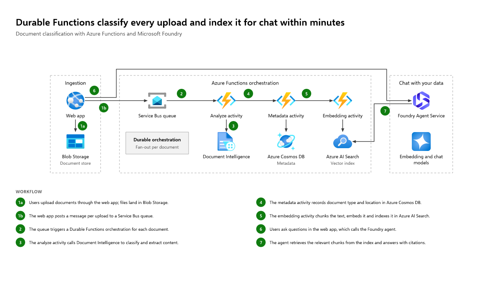
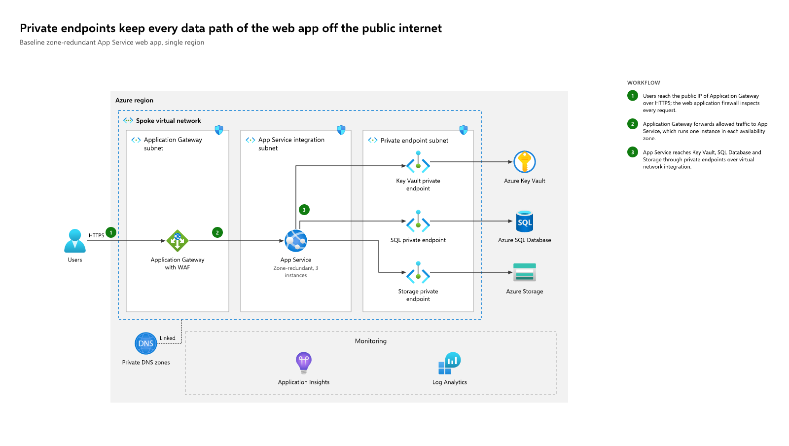
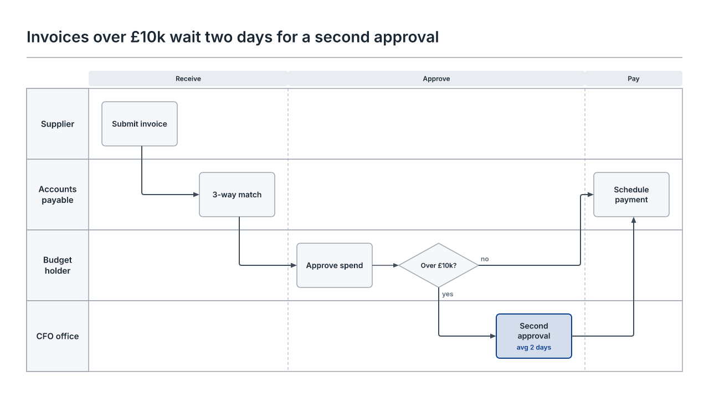

# Diagram Studio

A Claude Code plugin that designs diagrams with you. Describe what you need, or point it at an ARM export. Claude works out what the reader needs to see, shows two or three concepts on a live preview board, refines the one you pick, and exports editable PowerPoint, draw.io, SVG, PNG or PDF.

| Skill | Draws |
| --- | --- |
| `/diagram-studio:azure` | Azure architectures in the style of the Microsoft Azure Architecture Center, with the official Azure icons: solution workflows, network topologies, or a draft from your deployment |
| `/diagram-studio:business` | Business diagrams for leadership packs: operating models, swimlanes, roadmaps, value chains, 2x2 matrices and layered architectures |







Claude never draws anything itself. It writes a JSON spec, and a deterministic renderer (the [`diagram-studio`](engine/README.md) npm package, in [`engine/`](engine/)) does the layout, icons, styling, quality checks and export. Same spec, same picture, every time. The domain knowledge lives in the engine: the Azure style definition (from an analysis of 14 Microsoft reference architectures), the icon catalog, the layout rules and the ARM importer. The skills run the conversation.

## What you get

**Azure** (`/diagram-studio:azure`)

- **The right kind of diagram.** A *solution workflow* ("how does it work, step by step?") with green numbered steps and a workflow panel; a *network topology* ("where does it run, and how is traffic contained?") with regions, virtual networks, subnets, NSGs and private endpoints; or a *hybrid* that traces two or three flows across the topology, each with its own badge shape and a legend.
- **From your deployment.** Give it an ARM template (`az group export`, or a Bicep file built with `az bicep build`) or a resource list. It drafts the architecture as deployed, then curates it into a story with you.
- **Microsoft's house style.** The official icons (637 of them, with official names, about 400 aliases and ARM resource types), never recoloured or distorted. Boundaries nest the standard way (Azure > region > virtual network > subnet > zone), and lines run left to right without crossing unrelated boundaries.

**Business** (`/diagram-studio:business`)

- **The form that fits the content.** Layers for who serves whom, lanes for handoffs, horizons for what happens when, a chain for how value flows, a 2x2 for where to focus. Concepts differ in form or story, not just in colour.
- **Written for leaders.** Every title states the finding ("Invoices over £10k wait two days for a second approval"), and the renderer enforces how much detail each audience gets.
- **Your brand.** Seven themes, from boardroom navy to hand-drawn sketch, or a contrast-checked theme built from your brand colours.

**Both**

- **Pitched at the audience.** Executive (at most 9 boxes or services), management (up to 20) or detailed (up to 60), with fix-it messages when a diagram carries too much.
- **Exports you can keep editing.** A PowerPoint slide of native, grouped shapes, a draw.io file, SVG, PNG and vector PDF.

## Install

You need [Claude Code](https://claude.com/claude-code) and [Node.js](https://nodejs.org) 20 or later (`node --version`).

In Claude Code:

```
/plugin marketplace add Philcartmell/diagram-studio
/plugin install diagram-studio@diagram-studio
```

Or from a terminal:

```bash
claude plugin marketplace add Philcartmell/diagram-studio
claude plugin install diagram-studio@diagram-studio
```

Then restart Claude Code. That's all: the first session downloads the engine through `npx` (about 2 MB) and reuses it afterwards. To skip that download, install the engine yourself:

```bash
npm install -g diagram-studio
```

## Use

Ask for the diagram you want, or start a session explicitly:

```
/diagram-studio:azure Our AKS baseline for the architecture review: hub and spoke, private endpoints, two regions
/diagram-studio:business A slide for the ExCo on our IT operating model: service desk, platform engineering and architecture
```

Other things to try:

- "Show the ExCo how an uploaded document flows through our Functions pipeline to the chat app"
- "Here's `az group export` for rg-orders-prod. Turn it into a diagram for the security review"
- "What happens when East US 2 goes down? Show the failover"
- "Help me visualise our invoice approval process across four teams"
- "A 2x2 of our initiatives: value against effort"

Each diagram gets a session folder in your working folder:

```
diagrams/<name>/
  brief.md              the message, audience, content and what Claude assumed
  source/               your ARM template or resource list, if you gave one (Azure)
  concepts/a-…/         the concepts Claude proposed, side by side
  working/              the chosen design, with history/ for "go back to the previous one"
  exports/              the files you asked for, plus the spec for later changes
```

The preview board opens in your browser and refreshes after every change. In the Claude desktop app, Claude can open it in the built-in browser beside the chat. Refine it in plain words: "make finance stand out", "number the steps", "add private endpoints", "too busy", "for the wiki".

**Your own themes and icons** live in your user folder: `%APPDATA%\diagram-studio` on Windows, `~/.config/diagram-studio` elsewhere (`diagram-studio version` prints it). For example, Microsoft ships the Entra ID icon outside the Azure icon pack. Save the official SVG there as `azure-icons/entra-id.svg` and Claude can use it.

## Update

```bash
claude plugin marketplace update diagram-studio
claude plugin update diagram-studio@diagram-studio
```

(or use the `/plugin` menu), then restart Claude Code. Each plugin release names the engine version it was tested with, so the plugin and engine stay in step. If you installed the engine globally, update it too: `npm install -g diagram-studio`.

## The engine on its own

The renderer works without Claude, from any script or pipeline:

```bash
npm install -g diagram-studio
diagram-studio example azure-architecture > diagram.json
diagram-studio render diagram.json --all --out out
diagram-studio azure import template.json --out draft.json
diagram-studio docs guide
```

See [`engine/README.md`](engine/README.md).

## Develop

```bash
git clone https://github.com/Philcartmell/diagram-studio
cd diagram-studio/engine
npm ci            # installs dependencies and builds scripts/dist/
npm link          # your `diagram-studio` command now runs this checkout (undo: npm unlink -g diagram-studio)
npm test          # the full suite: golden renders, acceptance, stress, exports, CLI, docs
cd ..
claude --plugin-dir ./plugins/diagram-studio   # load the plugin from the folder; skill edits apply on the next start
```

```
.claude-plugin/marketplace.json     the marketplace (this repository)
plugins/diagram-studio/             the plugin, one skill per domain:
  skills/azure/                       Azure architectures
  skills/business/                    business diagrams
engine/                             the npm package "diagram-studio": source, assets, docs, tests
tools/release.mjs                   keeps the one shared version in step; see RELEASING.md
.github/workflows/                  CI on Windows, macOS and Linux; release on a version tag
```

A new domain (Databricks is next, see [ROADMAP.md](ROADMAP.md)) is a new skill folder in the plugin plus what the engine needs to draw it well: a style definition, icons and any new diagram type.

Releases: [RELEASING.md](RELEASING.md). Changes: [CHANGELOG.md](CHANGELOG.md).

## Licences

The code is MIT ([LICENSE](LICENSE)). The bundled fonts (Inter, IBM Plex Sans, Kalam, Source Sans 3, Selawik) are under the SIL Open Font License, and the Lucide icon subset under ISC; their licence files are in `engine/assets/`. The Azure architecture icons are Microsoft's, used under Microsoft's icon terms: see [`engine/assets/azure-icons/NOTICE.md`](engine/assets/azure-icons/NOTICE.md). Microsoft, Azure and the Azure icons are trademarks of the Microsoft group of companies; this project is not affiliated with or endorsed by Microsoft.
