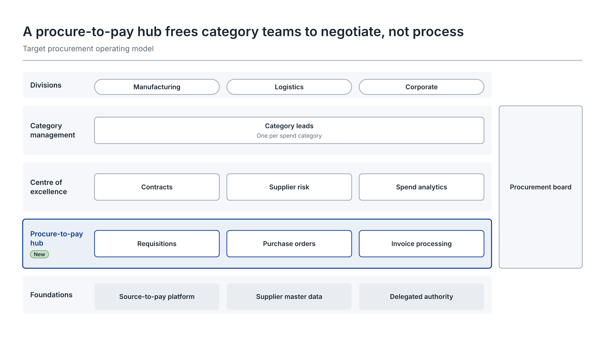
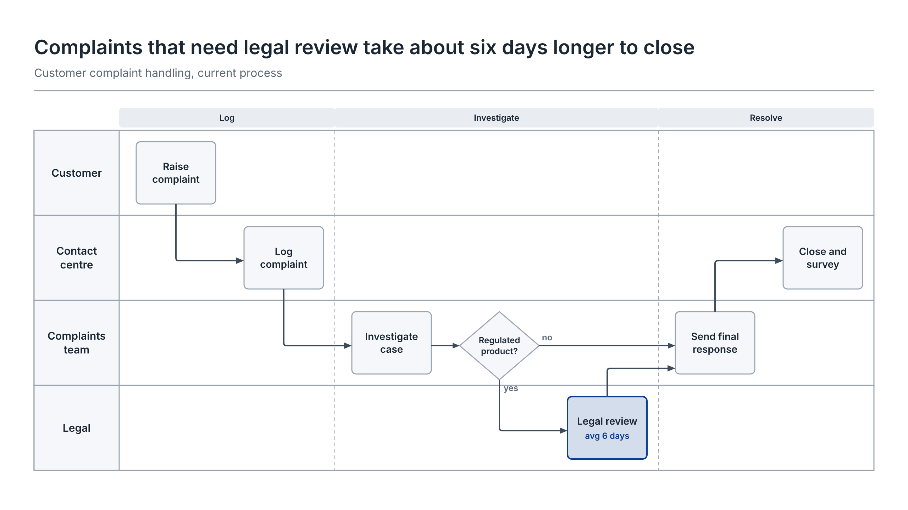
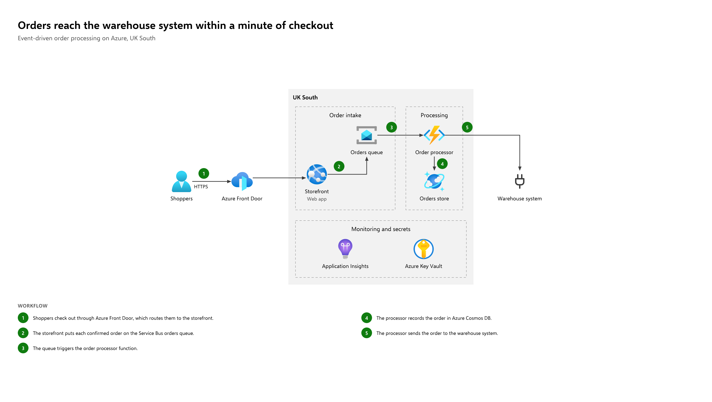
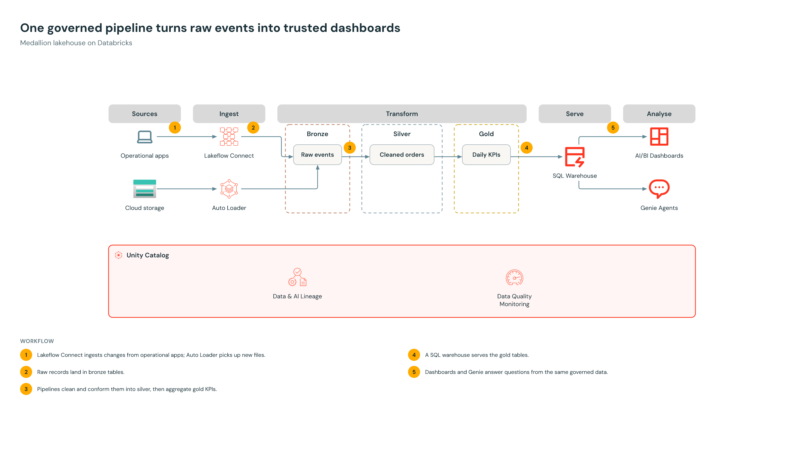
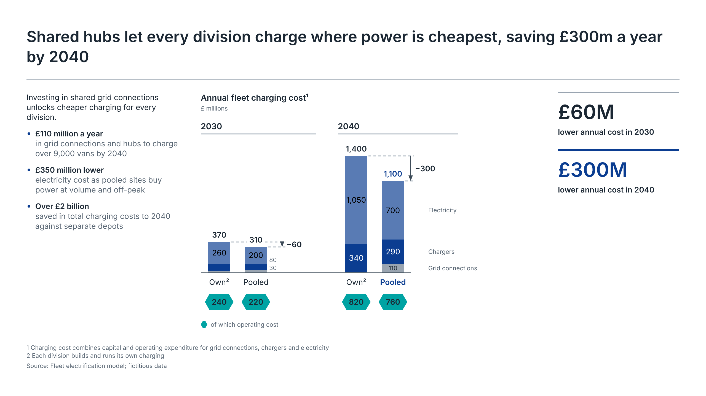

# Diagram Studio

A Claude Code plugin that designs diagrams with you. Describe what you need, or point it at an ARM export. Claude works out what the reader needs to see, shows two or three concepts on a live preview board, refines the one you pick, and exports editable PowerPoint, draw.io, SVG, PNG or PDF.

| Skill | Draws |
| --- | --- |
| `/diagram-studio:azure` | Azure architectures in the style of the Microsoft Azure Architecture Center, with the official Azure icons: solution workflows, network topologies, or a draft from your deployment. Azure Databricks workspaces included |
| `/diagram-studio:databricks` | Databricks architectures in the Databricks brand look, with the official Databricks product icons: lakehouse and medallion pipelines, workspace deployment topologies, platform maps |
| `/diagram-studio:business` | Business slides for leadership packs: operating models, swimlanes, roadmaps, value chains, 2x2 matrices and layered architectures, and consulting-style data exhibits (bar and column charts, waterfalls, line charts, KPI figures, and slides that combine them with text) |
| `/diagram-studio:deck` | Decks: agree the storyline, then build every page from any of the above and export one PowerPoint, PDF or draw.io file with consistent titles, theme, classification and page numbers |

## Examples

Each diagram below is drawn from the prompt above it: everything on it comes from the prompt, and the names and facts are made up. A prompt this specific goes straight to a diagram; a vaguer one gets a few questions first and two or three concepts to choose from on the live preview board.

**A business slide: an operating model**

```
/diagram-studio:business A slide for the ExCo on our target procurement operating model. We serve three divisions:
Manufacturing, Logistics and Corporate. Category leads (one per spend category) sit on top, a centre of excellence
covers contracts, supplier risk and spend analytics, and a new procure-to-pay hub handles requisitions, purchase
orders and invoice processing. Foundations: our source-to-pay platform, supplier master data and delegated authority.
The procurement board governs it. The point to land: the hub frees category teams to negotiate, not process.
```



**A process: a swimlane**

```
/diagram-studio:business Swimlane of our current complaint handling for the operations leadership team. The customer
raises a complaint, the contact centre logs it, and the complaints team investigates and checks whether it's a
regulated product. If it is, Legal reviews it, which takes about 6 days on average. Then the complaints team sends the
final response, and the contact centre closes the case and sends a survey. Phases: log, investigate, resolve.
```



**Azure: a solution workflow**

```
/diagram-studio:azure For the architecture review: shoppers check out over HTTPS through Azure Front Door to our
storefront web app in UK South. The storefront puts each order on a Service Bus queue, and an order processor Function
stores it in Cosmos DB and sends it to our warehouse system. Application Insights and Key Vault support it. The message:
orders reach the warehouse within a minute of checkout. Put the steps underneath.
```



**Databricks: a medallion lakehouse**

```
/diagram-studio:databricks Our medallion lakehouse for the data platform review. Lakeflow Connect ingests our
operational apps and Auto Loader picks up new files from cloud storage. Raw events land in bronze, are cleaned into
silver orders and aggregated into gold daily KPIs. A SQL warehouse serves AI/BI dashboards and Genie, and Unity Catalog
governs it all with lineage and data quality monitoring.
```



**A data exhibit: the argument, the chart and the headline numbers**

```
/diagram-studio:business One exhibit for the board on pooling fleet charging. Annual charging cost in £ millions,
split into grid connections, chargers and electricity: 2030 separate depots 20 / 90 / 260, pooled 30 / 80 / 200;
2040 separate 10 / 340 / 1,050, pooled 110 / 290 / 700. Operating cost is 240, 220, 820 and 760. Show the saving
between the options in each year, the 2040 saving as the headline, and three supporting points on the left:
£110m a year in grid connections and hubs, £350m lower electricity cost, over £2bn saved to 2040.
```



The engine adds up the totals and the differences itself, from the figures you give it.

**A deck: several pages, one file**

```
/diagram-studio:deck A nine-page steering committee pack on the platform and fleet charging investment case, confidential.
Use the fleet charging exhibit, the margin bridge and the cloud survey charts as evidence, then the finance operating model,
the medallion pipeline and the claims portal architecture with its cost case.
```


## How it works

Claude never draws anything itself. It writes a JSON spec, and a deterministic renderer (the [`diagram-studio`](engine/README.md) npm package, in [`engine/`](engine/)) does the layout, icons, styling, quality checks and export. Same spec, same picture, every time. The domain knowledge lives in the engine: the Azure style definition (from an analysis of 14 Microsoft reference architectures), the Databricks style definition (from 17 Databricks diagram sources and Microsoft's Azure Databricks diagrams), the Azure and Databricks icon catalogs, the layout rules and the ARM importer. The skills run the conversation.

## What you get

**Azure** (`/diagram-studio:azure`)

- **The right kind of diagram.** A *solution workflow* ("how does it work, step by step?") with green numbered steps and a workflow panel; a *network topology* ("where does it run, and how is traffic contained?") with regions, virtual networks, subnets, NSGs and private endpoints; or a *hybrid* that traces two or three flows across the topology, each with its own badge shape and a legend.
- **From your deployment.** Give it an ARM template (`az group export`, or a Bicep file built with `az bicep build`) or a resource list. It drafts the architecture as deployed, then curates it into a story with you.
- **Microsoft's house style.** The official icons (637 of them, with official names, about 400 aliases and ARM resource types), never recoloured or distorted. Boundaries nest the standard way (Azure > region > virtual network > subnet > zone), and lines run left to right without crossing unrelated boundaries.

**Databricks** (`/diagram-studio:databricks`)

- **The right kind of diagram.** A *use-case data flow* (stages from sources to consumers, bronze, silver and gold layers, Unity Catalog underneath, numbered steps); a *deployment topology* (what runs in the Databricks account and what in your cloud account); or a *platform reference map* (the navy platform block of workload panels between your sources and consumers).
- **Databricks' house style.** DM Sans, navy and grey-blue, oat panels, lava kept for the Databricks account and Unity Catalog, amber and blue numbered paths. The official product artwork for 71 Databricks products, with former names (Delta Live Tables, Workflows, Vector Search) understood.
- **Databricks inside Azure.** In an Azure diagram, an Azure Databricks workspace holds Databricks product icons, the Microsoft way: control plane outside your subscription, VNet injection, medallion layers beside ADLS Gen2.
- **Governance designs on Azure Databricks.** Who can reach which data, models and secrets, through which identity: one slice per team in a shared workspace, with Entra groups, catalogs, storage and service credentials, access connectors and managed identities, Key Vault-backed secret scopes, Microsoft Foundry models through Unity Gateway and sources in other subscriptions. Databricks terms stay inside the workspace, Azure terms outside, and every arrow carries its permission. `diagram-studio example azure-architecture --n 5` is the full pattern.
- **Current names.** Databricks renames features often (Delta Live Tables, Workflows, AI Gateway). The skills check current docs when a design depends on how a product works today, and say when your term has changed.

**Business** (`/diagram-studio:business`)

- **The form that fits the content.** Layers for who serves whom, lanes for handoffs, horizons for what happens when, a chain for how value flows, a 2x2 for where to focus. Concepts differ in form or story, not just in colour.
- **Written for leaders.** Every title states the finding ("Invoices over £10k wait two days for a second approval"), and the renderer enforces how much detail each audience gets.
- **Your brand.** Seven themes, from boardroom navy to hand-drawn sketch, or a contrast-checked theme built from your brand colours.
- **Charts the consulting way.** Figures on the data rather than on an axis, totals and difference arrows computed from your values (a waterfall whose total does not add up is refused), series named beside the bars, one accent. Exhibits put a chart beside its argument, line up small multiples, or set an Azure or Databricks architecture next to the numbers that justify it.

**Decks** (`/diagram-studio:deck`)

- **Storyline first.** Claude drafts one action title per page and agrees them with you before drawing; the render writes them out as a storyline so you can check the argument.
- **Any page type.** Business diagrams, charts, exhibits, Azure and Databricks architectures, title pages and section dividers. A page can point at a diagram you designed in another session, so later edits there flow into the deck.
- **Consistent by construction.** One theme and canvas, every action title in the same place, "Exhibit N" trackers, classification and page numbers on every page. One PowerPoint (a slide per page), one bookmarked PDF, one draw.io file with a tab per page.

**All the skills**

- **Pitched at the audience.** Executive (at most 9 boxes or services), management (up to 20) or detailed (up to 60), with fix-it messages when a diagram carries too much.
- **Exports you can keep editing.** A PowerPoint slide of native, grouped shapes, a draw.io file, SVG, PNG and vector PDF.

## Install

You need [Claude Code](https://claude.com/claude-code) and [Node.js](https://nodejs.org) 20 or later (`node --version`).

In Claude Code:

```
/plugin marketplace add Philcartmell/diagram-studio
/plugin install diagram-studio@diagram-studio
```

Or from a terminal:

```bash
claude plugin marketplace add Philcartmell/diagram-studio
claude plugin install diagram-studio@diagram-studio
```

Then restart Claude Code. That's all: the first session downloads the engine through `npx` (about 2 MB) and reuses it afterwards. To skip that download, install the engine yourself:

```bash
npm install -g diagram-studio
```

## Use

Ask for the diagram you want, or start a session explicitly:

```
/diagram-studio:azure Our AKS baseline for the architecture review: hub and spoke, private endpoints, two regions
/diagram-studio:databricks Our medallion lakehouse: orders and clickstream into bronze, silver and gold, served to Power BI
/diagram-studio:business A slide for the ExCo on our IT operating model: service desk, platform engineering and architecture
```

Other things to try:

- "Show the ExCo how an uploaded document flows through our Functions pipeline to the chat app"
- "Here's `az group export` for rg-orders-prod. Turn it into a diagram for the security review"
- "What happens when East US 2 goes down? Show the failover"
- "How does our Databricks workspace deploy into our Azure subscription? Show the control plane and VNet injection"
- "Map our Databricks platform for the steering group"
- "Show how each team in our shared Databricks workspace is kept apart: their groups, catalogs, storage, identities and Key Vaults"
- "Add Foundry models for the data science team, through Unity Gateway, using the team's own managed identity"
- "Help me visualise our invoice approval process across four teams"
- "A 2x2 of our initiatives: value against effort"

Each diagram gets a session folder in your working folder:

```
diagrams/<name>/
  brief.md              the message, audience, content and what Claude assumed
  source/               your ARM template or resource list, if you gave one (Azure)
  concepts/a-…/         the concepts Claude proposed, side by side
  working/              the chosen design, with history/ for "go back to the previous one"
  exports/              the files you asked for, plus the spec for later changes
```

The preview board opens in your browser and refreshes after every change. In the Claude desktop app, Claude can open it in the built-in browser beside the chat. Refine it in plain words: "make finance stand out", "number the steps", "add private endpoints", "too busy", "for the wiki".

**Your own themes and icons** live in your user folder: `%APPDATA%\diagram-studio` on Windows, `~/.config/diagram-studio` elsewhere (`diagram-studio version` prints it). For example, Microsoft ships the Entra ID icon outside the Azure icon pack. Save the official SVG there as `azure-icons/entra-id.svg` and Claude can use it.

## Update

```bash
claude plugin marketplace update diagram-studio
claude plugin update diagram-studio@diagram-studio
```

(or use the `/plugin` menu), then restart Claude Code. Each plugin release names the engine version it was tested with, so the plugin and engine stay in step. If you installed the engine globally, update it too: `npm install -g diagram-studio`.

## The engine on its own

The renderer works without Claude, from any script or pipeline:

```bash
npm install -g diagram-studio
diagram-studio example azure-architecture > diagram.json
diagram-studio render diagram.json --all --out out
diagram-studio azure import template.json --out draft.json
diagram-studio databricks icons unity catalog
diagram-studio docs guide
```

See [`engine/README.md`](engine/README.md).

## Develop

```bash
git clone https://github.com/Philcartmell/diagram-studio
cd diagram-studio/engine
npm ci            # installs dependencies and builds scripts/dist/
npm link          # your `diagram-studio` command now runs this checkout (undo: npm unlink -g diagram-studio)
npm test          # the full suite: golden renders, acceptance, stress, exports, CLI, docs
npm run azure-icons -- "<Azure icon pack>/Icons"              # refresh the Azure icons (the Azure Architecture Center download)
npm run databricks-icons -- databricks-architecture-icons-all.zip   # refresh the Databricks icons (the pack's "Download all" zip)
cd ..
claude --plugin-dir ./plugins/diagram-studio   # load the plugin from the folder; skill edits apply on the next start
```

```
.claude-plugin/marketplace.json     the marketplace (this repository)
plugins/diagram-studio/             the plugin, one skill per domain:
  skills/azure/                       Azure architectures (Azure Databricks included)
  skills/databricks/                  Databricks architectures
  skills/business/                    business diagrams
engine/                             the npm package "diagram-studio": source, assets, docs, tests
tools/release.mjs                   keeps the one shared version in step; see RELEASING.md
.github/workflows/                  CI on Windows, macOS and Linux; release on a version tag
```

Each domain is a skill folder in the plugin plus what the engine needs to draw it well: a style definition, an icon catalog, boundary kinds and a theme. Databricks was added that way; see [ROADMAP.md](ROADMAP.md) for what is next.

Releases: [RELEASING.md](RELEASING.md). Changes: [CHANGELOG.md](CHANGELOG.md).

## Licences

The code is MIT ([LICENSE](LICENSE)). The bundled fonts (Inter, IBM Plex Sans, Kalam, Source Sans 3, Selawik, DM Sans) are under the SIL Open Font License, and the Lucide icon subset under ISC; their licence files are in `engine/assets/`. The Azure architecture icons are Microsoft's, used under Microsoft's icon terms: see [`engine/assets/azure-icons/NOTICE.md`](engine/assets/azure-icons/NOTICE.md). The Databricks icons are Databricks' artwork, gathered by a community collection: see [`engine/assets/databricks-icons/NOTICE.md`](engine/assets/databricks-icons/NOTICE.md). Microsoft, Azure and the Azure icons are trademarks of the Microsoft group of companies; Databricks, the Databricks logo and the product names are trademarks of Databricks, Inc. This project is not affiliated with or endorsed by Microsoft or Databricks.
